<div align="center">



<br/>

[](https://imadhimthiyas.nl)
[](mailto:hello@imadhimthiyas.nl)


</div>

---

### `>_ about.sh`

```bash
$ cat about.md

role     : Full-Stack Developer
focus    : POS & management systems
building : multi-tenant SaaS platforms
stack    : PHP, Laravel, TypeScript, MySQL
mindset  : clean code, fast interfaces
status   : open to freelance work
```

### `>_ stack.json`

<div align="center">


</div>

### `>_ systems.log`

- **Ivenza POS**: sales, purchases, repairs, returns and SMS for mobile and retail shops
- **MSMS Central**: licensing, updates, announcements and backups across clients
- **Perfume POS**: GRN, decant, offers, payroll and accounting
- **PC Monitor**: device-uptime monitoring with push alerts (PWA)
- **JAJM**: masjid management system with a member portal

> Client work is kept in private repositories. Source is available on request.

### `>_ connect.sh`

```bash
$ ./connect.sh

web    →  https://imadhimthiyas.nl
mail   →  hello@imadhimthiyas.nl
```

<div align="center">



</div>
